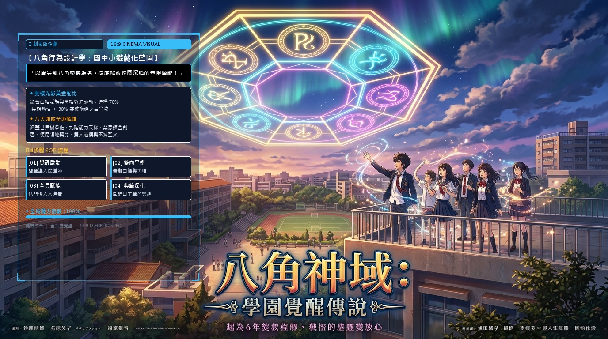
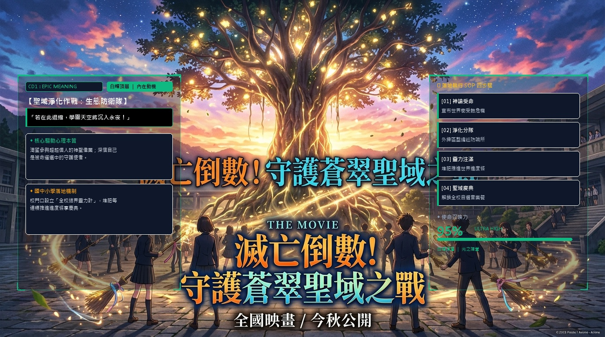
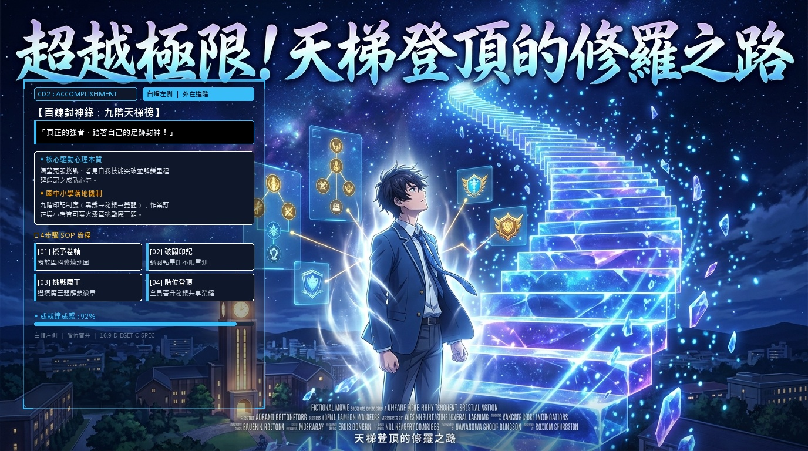
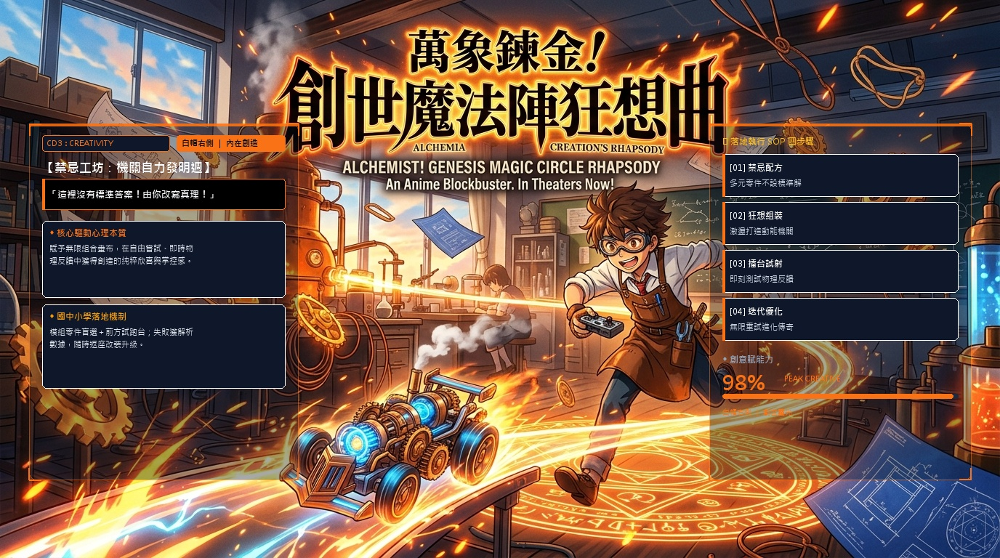
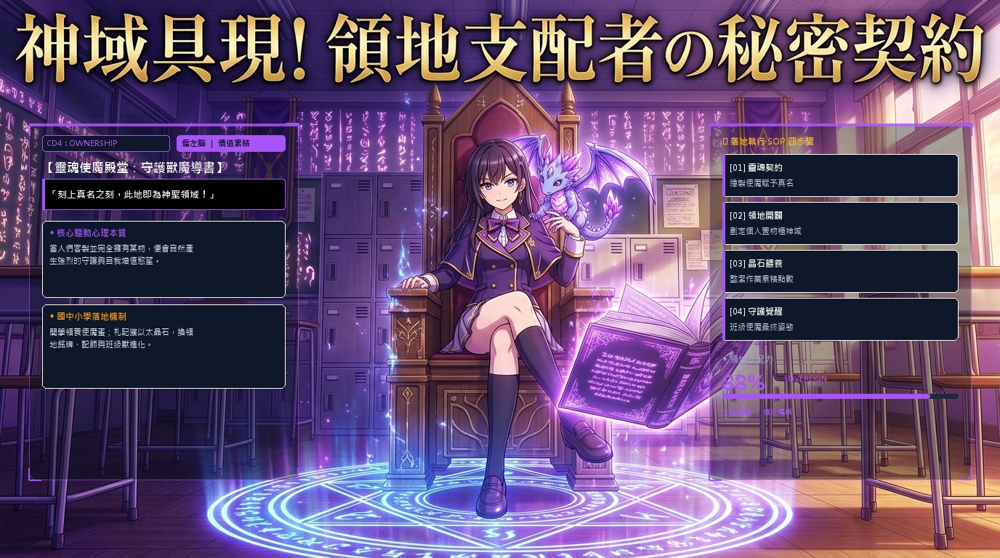
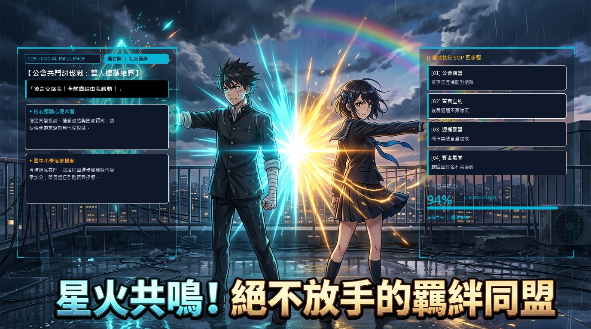
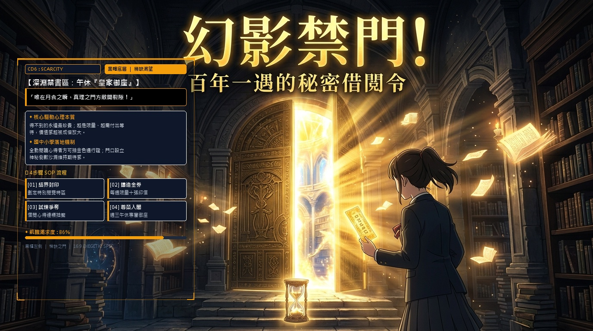
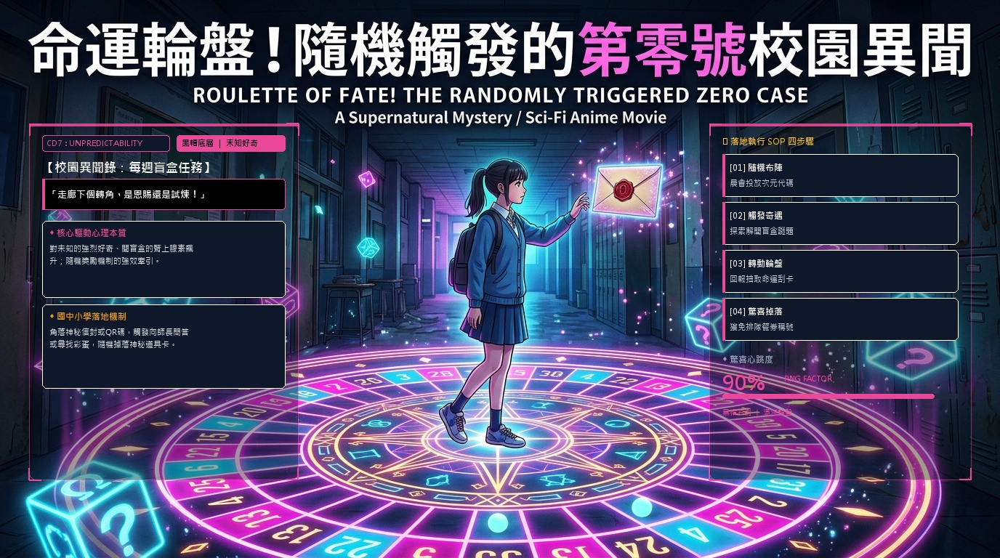
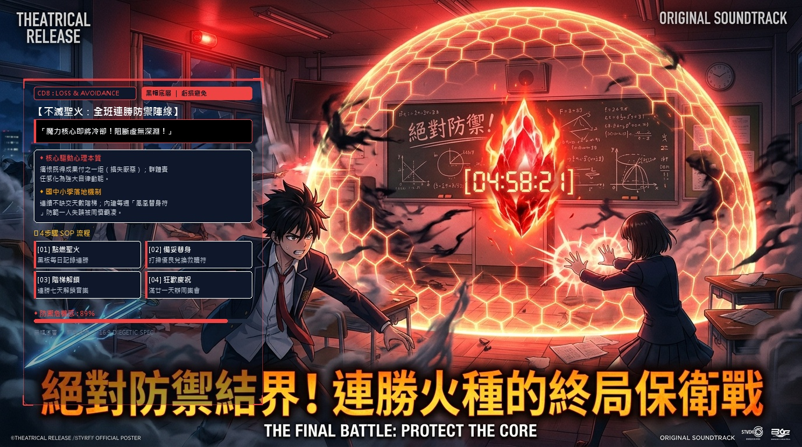

# 🎬 視覺化資訊圖表型簡報生成引擎 (Visual Infographic Deck)
### ⚡ Google Antigravity 專用 Agent 技能（Antigravity-Exclusive Skill）
> **以周昱凱八角遊戲化架構（Octalysis）為實戰典範，徹底告別傳統呆板的醜簡報！**

[](https://github.com/vincentchiou/antigravity-visual-infographic-deck)
[](https://github.com/vincentchiou/antigravity-visual-infographic-deck)
[](https://github.com/vincentchiou/antigravity-visual-infographic-deck)
[](https://github.com/vincentchiou/antigravity-visual-infographic-deck)

---

## 🌟 核心理念與設計鐵則（Philosophy & Rules）

1. **🚫 絕對拒絕醜簡報**：
   - 拋棄傳統簡報條列式文字堆疊、白底黑字與毫無美感的方塊。
   - 全面以 **16:9 橫向超寬螢幕（1920×1080）** 日本院線動漫電影海報風格打造。
2. **🖼️ 頁頁獨立專屬背景**：
   - 拒絕千篇一律的套版背景，每一頁均擁有量身打造的高清概念藝術場景。
3. **✨ 原畫文字與主體零遮擋（Diegetic Zero-Overlap）**：
   - 精算每張圖片的天然留白空間（天空、窗景、陰影區），資訊方塊採用 **高透光全息磨砂毛玻璃（`alpha=90`）** 搭配科幻直角標記（`┌ ┐ └ ┘`）。
   - 圖片自身所帶的日文書法片名、主標題與主角面部 **100% 完整裸露**！
4. **🖋️ 電影級字藝層級規範**：
   - 特大主標、優雅名言光條、雙晶片卡、`01~04` 特大阿拉伯數字步驟時間軸與巨幕 HUD 能量數值，層次井然有序。
5. **🤖 代理人四重角色協同**：
   - **主任先行**（擬定作戰計畫與討論）➔ **專員分工**（內容、美術、排版並行）➔ **檢察員嚴格審查**（五維逐項稽核修正）➔ **正式驗收**。

---

## 📥 如何在 Google Antigravity 中安裝與使用

### 方法 A：工作區安裝（推薦單一專案使用）
將本專案的 `.agent/skills/visual-infographic-deck/` 資料夾複製到您的專案根目錄下：
```text
your-project/
└── .agent/
    └── skills/
        └── visual-infographic-deck/
            └── SKILL.md
```

### 方法 B：全域安裝（跨專案隨時可用）
將技能檔案複製至 Antigravity 全域設定目錄：
- **Windows**: `C:\Users\<username>\.gemini\config\skills\visual-infographic-deck\SKILL.md`
- **macOS / Linux**: `~/.gemini/config/skills/visual-infographic-deck/SKILL.md`

### 💬 召喚指令範例
在 Google Antigravity 對話框中直接對 Agent 輸入：
```text
請使用「視覺化資訊圖表型簡報 SKILL」幫我製作：[主題名稱]，受眾為[目標客群]，風格為[風格偏好]
```
Agent 即會自動化身專案主任，啟動整套高規格電影海報圖表製作與雙版本 PDF 封裝管線！

---

## 🎨 典範成果展覽：八角神域（Octalysis 國中小學實踐）

| 頁碼 / 核心驅動力 | 16:9 劇場版海報視覺 | 國中小落地實戰機制 |
| :---: | :--- | :--- |
| **Cover 總覽** |  | **【八角神域：學園覺醒傳說】**<br>八角全域架構導覽，70% 白帽賦能 ＋ 30% 黑帽緊迫黃金配比。 |
| **CD1 使命呼召** |  | **【滅亡倒數！守護蒼翠聖域之戰】**<br>外掃區落葉與分類化為修復全校世界樹靈力進度條之神聖戰役。 |
| **CD2 進步成就** |  | **【超越極限！天梯登頂的修羅之路】**<br>九階技能樹卷軸與火漆章制度，隨堂小考自主晉級天梯。 |
| **CD3 賦予創意** |  | **【萬象鍊金！創世魔法陣狂想曲】**<br>跨領域創客工坊，自組動力魔導車於即時試射擂台進行無限試錯。 |
| **CD4 所有權感** |  | **【神域具現！領地支配者的秘密契約】**<br>置物櫃神域化，以日常學習紀錄孵化個人使魔與班級圖騰。 |
| **CD5 社交同理** |  | **【星火共鳴！絕不放手的羈絆同盟】**<br>互補專長組隊共鬥，一人突破全隊暴擊加成，營造互信無排擠班級。 |
| **CD6 稀缺渴望** |  | **【幻影禁門！百年一遇的秘密借閱令】**<br>圖書館封印特區，每週全校限量10席，以稀缺性引爆深度閱讀。 |
| **CD7 未知好奇** |  | **【命運輪盤！隨機觸發的第零號異聞】**<br>穿堂散落次元裂縫 QR 碼，隨機觸發向師長挑戰與命運刮刮卡。 |
| **CD8 虧損避免** |  | **【絕對防禦結界！連勝火種的終局保衛戰】**<br>全班全勤作業連勝機制，內建鳳凰替身符抵禦失誤，化被動為自律。 |

---

## 📦 專案核心產出清單

- 📑 **[`Octalysis_Campus_Infographics_16x9.pdf`](Octalysis_Campus_Infographics_16x9.pdf)**：完整 9 頁 16:9 電影海報級視覺化資訊圖表全集。
- 🎨 **[`Octalysis_Theatrical_Posters_16x9.pdf`](Octalysis_Theatrical_Posters_16x9.pdf)**：完整 9 頁純淨原畫海報畫冊（供巨幕投屏或印製大張海報）。
- 🌐 **[`index.html`](index.html)**：互動式 16:9 展覽館網站（內建魔導陣雷達圖、雙側浮空儀表與純享原畫按鈕）。
- 🛠️ **[`build_poster_deck.py`](build_poster_deck.py)**：Python 批次繪圖與無損向量 PDF 自動封裝建置腳本。
- 📋 **[`qa_inspection_report.md`](qa_inspection_report.md)**：五階段品質檢察員嚴格審查與驗收改善報告。
- 📜 **[`視覺化資訊圖表型簡報_SKILL.md`](視覺化資訊圖表型簡報_SKILL.md)**：完整 Agent Skill 規範手冊。

---

## 📄 License
MIT License. Crafted for **Google Antigravity** & Advanced Agentic Coding.
